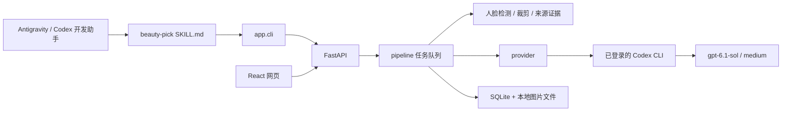

# 颜选 · BeautyPick：Antigravity 项目与 Skill 交接

交接日期：2026-10-15，America/Los_Angeles。本文基于本轮读取的本地代码、数据库和实际检查，不把历史规划当成现状。

## 1. 接手目标与交付范围

用户希望在 Antigravity 中继续优化这个项目及配套 skill。当前是一个已经实现并存有真实测试数据的本机 Web 应用，不需要重新从零搭建。

必须区分两个层次：

- **BeautyPick 应用**：网页、API、SQLite、图片文件、评分规则、模型调用与任务队列。
- **beauty-pick skill**：指导开发助手通过现有 CLI/API 使用应用的操作说明。它不是独立评分算法，也没有单独的数据存储。

只修改 `SKILL.md` 不会直接改变模型打分。产品评分提示由 `app/scoring.py` 生成，`app/provider.py` 调用 Codex CLI 时明确关闭了 skills、插件、浏览等能力。开发助手可以是 Antigravity，产品运行时仍是用户指定的 Codex CLI。

本次交接只新增本文、[交接提示词](ANTIGRAVITY_PROMPT.md)和[状态快照](docs/handoff/beautypick-state-2026-10-15.json)，未执行新的真实模型评分，未修改应用评分规则或既有 skill。

## 2. 名称、路径与 Antigravity 入口

| 项目 | 当前值 |
| --- | --- |
| 中文名 | 颜选 |
| 英文名 | BeautyPick，用户已经确定，不再重新讨论候选名 |
| 项目根目录 | `/Users/neo/inbox/beautypick` |
| 当前 skill 标识 | `beauty-pick` |
| Skill 原件 | `/Users/neo/.agents/skills/beauty-pick/SKILL.md` |
| Antigravity 全局入口 | `/Users/neo/.gemini/config/skills/beauty-pick` |
| 入口实际形式 | 上述入口是指向 `/Users/neo/.agents/skills/beauty-pick` 的符号链接 |
| 本机 Antigravity | 已发现 `/Applications/Antigravity.app`，版本 2.23.1 |
| 默认网页地址 | `http://127.0.0.1:8765/` |

**最新路径变化**：整理交接期间，磁盘上的 skill 已从 `portrait-evaluator` 更新为 `beauty-pick`，Antigravity 全局链接也已存在。这个变动不是本轮交接文档创建步骤执行的。旧的 `/Users/neo/.agents/skills/portrait-evaluator/SKILL.md` 已不存在；本聊天的旧技能目录、README 和部分历史记录仍可能引用旧名。请以当前磁盘实际文件为准，不要恢复旧目录或覆盖较新的修改。

项目目录此前从 `ai-portrait-evaluator` 改为 `beautypick`，虚拟环境脚本里的绝对路径已修复，迁移后的启动检查已通过。不要继续用旧项目目录。

根据 [Antigravity 官方 skill 文档](https://antigravity.google/docs/skills?app=antigravity-ide)，IDE 支持工作区的 `.agents/skills/<名称>/` 和全局的 `~/.gemini/config/skills/<名称>/`。当前已有全局链接，优先复用，不必另建一个独立维护的副本。进入 Antigravity 后在 Customizations 中检查能否发现 `beauty-pick`；若没有，先让助手直接读取 skill 原件，再排查该版本的发现机制。**本轮没有在 Antigravity 界面内实际验证发现和执行，不能把“链接存在”写成“集成已验收”。**

## 3. 当前状态：已核实的事实

| 检查项 | 结果 |
| --- | --- |
| 未删除照片 | 13 张，均有原图、裁脸和三模块评分 |
| 历史评分快照 | 91 条，保存在 `assessments` |
| 模型调用台账 | 119 条，是历史尝试记录，不是额度，也不等于 119 次全部成功 |
| 人物分组 | 1 个项目、8 个代表照分组 |
| 现有照片保留状态 | 全部 `retained=1` |
| 现有颜值版本 | 全部 `portrait-face-0.8`，状态 completed |
| 运行中/排队任务 | 0 |
| 数据库快速检查 | `PRAGMA quick_check` 返回 ok |
| 8765 端口 | 本轮核查时没有监听；浏览器保留旧标签页不代表服务仍在运行 |
| Git | 项目目录未发现 `.git`，没有可交付的提交或远程分支信息 |

本轮在新目录重新执行：

- `.venv/bin/python -m pytest -q`：**37 passed**；有一条 Starlette/httpx TestClient 弃用提示，没有测试失败。
- `npm run build --prefix web`：通过。
- `npm run lint --prefix web`：通过。
- 上次目录迁移检查：启动脚本可用，13 张图片、91 条历史及原图/裁脸/报告内容完整保留。

这些测试验证现有实现行为，不证明审美算法正确、评分稳定或最终产品已通过全部原规划验收。TODO 中仍有未完成的多条件用例与审美校准。

## 4. 技术架构与关键文件

后端 Python 3.13.0、FastAPI、Pydantic、Pillow、OpenCV、MediaPipe、c2pa-python；前端 React 19、TypeScript、Vite 8、lucide-react。核查时 Node 为 v22.23.1。依赖环境已经存在，Python 锁文件是 `requirements.lock`，前端使用 `web/package-lock.json`。



| 文件 | 责任与接手关注点 |
| --- | --- |
| `app/main.py` | API、上传、目标面孔、授权状态、导出、静态前端；查看实际路由和参数 |
| `app/scoring.py` | 三模块规则、分档、Pydantic Schema、提示词、总分与版本号；颜值优化的主要入口 |
| `app/provider.py` | Codex CLI 子进程、图片输入、JSON Schema、取消、180 秒超时、用量解析及肤色辅助上下文 |
| `app/pipeline.py` | 本地报告、队列、缓存、版本、模块调用、取消与迟到结果拒写、历史落库 |
| `app/images.py` | EXIF 方向处理、BlazeFace、人脸裁剪、清晰度门槛、近似面部色彩测量 |
| `app/provenance.py` | C2PA/EXIF、来源证据、用户说明与展示来源；没有通用 AI 真伪检测器 |
| `app/storage.py` | SQLite、图片路径、保留/删除、旧版分数隔离、标签和本地点心投票 |
| `app/comparison.py` | 已保存分项的确定性排行与权重重算，不额外送两张图给模型比较 |
| `app/cli.py` | 使用同一个本地 HTTP API 的命令行入口 |
| `web/src/App.tsx`、`Simple.css` | 当前主界面；不要把旧截图当成现状 |
| `web/src/Ranking.tsx` | 遗留排行组件，当前主 App 未引入；部分文案与最新主界面不同 |
| `tests/test_core.py`、`tests/test_c2pa_crypto.py` | 本地回归测试；生产数据不是测试临时库 |
| `models/` | 本地 BlazeFace 模型与离线 C2PA 信任锚；来源和校验值见该目录 README |

`web/package.json` 的 `name=web`、`version=0.0.0` 是脚手架元信息，不是当前产品发布版本。产品评分版本由 Python 代码决定。

## 5. 启动、检查与调用

在 Antigravity 打开 `/Users/neo/inbox/beautypick`。先只读核对服务与进程，避免重复启动。

终端一：

```sh
cd /Users/neo/inbox/beautypick
./start.sh
```

服务只绑定 `127.0.0.1`，默认端口 8765。保持单进程、单 worker；生产分析队列不要使用 `--reload`。用 Ctrl+C 正常停止。启动不安装依赖，也不自动评分。

终端二：

```sh
cd /Users/neo/inbox/beautypick
.venv/bin/python -m app.cli --help
.venv/bin/python -m app.cli status
.venv/bin/python -m app.cli list
```

状态中的 `provider_available` 只表示能找到 `codex`，不证明登录、网络或真实调用成功。本轮找到的 CLI 位于 `/Applications/ChatGPT.app/Contents/Resources/codex-cli/CodexCLI.app/Contents/MacOS/codex`。优先通过 PATH 使用；Antigravity 的终端 PATH 可能不同，需要实际检查。不要读取、复制或移动登录凭证，不要为省事修改全局 Codex 配置。

已有授权范围内的单张颜值真实重评示例：

```sh
.venv/bin/python -m app.cli analyze d08a4166-397d-48ea-b2ec-c1ed64337594 --allow-cloud --adult-confirmed --modules face --force --wait
```

这是一个真实云端调用示例，**不是接手时必须立即执行的检查**。先用本地测试确认实现，再按本轮明确的验证目标选小样本。`--force` 才能绕过同版本缓存；未强制调用而复用缓存，不能宣称完成独立重复试验。

当前网页上的“重新分析”会重新分析颜值、身材、摄影三项。研发中只重测颜值可显式指定 `--modules face`；不要误称这种单模块测试等于网页三模块重评。

直接调 API 时使用同一 `httpx.Client` 获取 `/api/session` 并保留 cookie，将返回 token 用于 `x-portrait-token`；不要把 token 写进文档或日志。CLI 已处理这些步骤。常用 API：

- `POST /api/assets/{id}/analyze`：`modules`、`force`、`body_scoring`；返回 job_id。
- `GET /api/jobs`、`POST /api/jobs/{job_id}/cancel`：核对真实任务状态，失败不得用旧分冒充新结果。
- `POST /api/assets/{id}/target`：归一化 `x/y/width/height` 选脸矩形。
- `GET /api/assets/{id}/history`、`GET /api/assets/{id}/export.html`：历史与导出。

## 6. 产品运行时与边界

- 用户选定的评分模型：**`gpt-6.1-sol`，`medium`**，配置在 `app/config.py`。开发助手换到 Antigravity 不代表获得了替换产品模型的授权。
- 使用本机已登录 Codex CLI，不使用 OpenAI API Key；产品需要视觉理解评分，不是调用图像生成模型。
- 颜值发送裁脸；身材与摄影发送清理元数据后的整图。模块分开，不计算颜值/身材/摄影的混合总分。
- 两个任务 worker、两个全局模型 worker，目前最多两个模块调用并行，不是无限并发。每次模型调用上限 180 秒，仍保留取消、上传大小、像素等限制。
- 每日调用限制默认 `PORTRAIT_DAILY_CALL_LIMIT=0`，表示应用不限制每日次数；正整数才开启对应上限。不要恢复旧 24 次上限，也不要把账号额度等同于本地应用限制。
- 上传限制默认每张 20 MB、2500 万像素；JPEG、PNG、静态 WebP。
- 测试已有图片可沿用此前用户给定的处理范围；最初 8 张已明确确认是成年人物的 AI 生成/编辑素材。当前 13 张有成年和外发授权字段记录，字段记录不等于模型识别了年龄。新素材仍遵守仅成年人范围，不猜年龄。
- 新平台外发、换模型、付费接入、公开部署或清空现有数据需要用户决策，不由技能迁移自动扩展授权。

## 7. 三模块评分现状

### 7.1 颜值

规则版本 `portrait-face-0.8`，提示版本 `portrait-face-bands-20261014-1`。

| 分项 | 权重 |
| --- | ---: |
| 眉眼 eyes | 20 |
| 鼻唇 nose_lips | 20 |
| 五官协调 harmony | 25 |
| 脸型轮廓 face_shape | 25 |
| 皮肤呈现 skin | 10 |

子分 0–10，最多一位小数。总分 `Σ(子分 × 权重 / 10)`，十进制定点四舍五入至一位小数。五项中任何必要项不可评，总分仍为 null，不把缺失填 0。`face_total_score` 当前复用了身材的小数加权辅助函数，但颜值最后仍检查缺项；重构时不要误把身材的缺项重分权重规则带入颜值。

| 百分制总分区间 | 含义 |
| --- | --- |
| 0.0–39.9 | 可见美感呈现较弱，需具体依据 |
| 40.0–59.9 | 普通 |
| 60.0–74.9 | 顺眼、有局部优势 |
| 75.0–84.9 | 明显漂亮 |
| 85.0–94.9 | 很漂亮、整体突出 |
| 95.0–100.0 | 极突出 |

表情、神态、微笑、是否看镜头不计入颜值。用户希望评选面部美感，而不是奖励微笑、正面、高清或拍摄技巧。额头、眉毛、眼睛、鼻子、嘴唇、面颊、下颌与下巴分别归入相关维度，避免重复加分。

皮肤按用户选定的照片呈现偏好观察明净、白里透红、均匀性与自然度。该偏好是当前产品案例的审美设定，不能当成人群通用标准，更不能推断健康、真实肤质或因自然深肤色本身扣分。不要把 AI 磨皮和过曝当成好皮肤。

色彩辅助：`face_color_profile` 再检测裁脸中的人脸，以宽泛 YCrCb 门槛选近似肤色像素，输出 Lab 中位数。provider 另有 `L*>=60 且 b*<=19`、`L*<=57 且 b*>=22` 的视觉复核提示。它没有精确皮肤分割，阈值来自小样本迭代，没有独立大样本验证，也不直接换算为分数。它可能受光照、妆容、背景混入与检测框影响，不能包装成成熟肤质算法。

### 7.2 身材

规则版本 `body-appearance-3.0`，提示版本 `portrait-body-parts-20261014-5`。显示名称用“身材”。六项：肩胸 25、腰腹 20、臀胯 15、腿部 15、比例 15、协调 10。

用户明确要求用“肩胸”，不要自行换成“肩胸轮廓”。胸部是观察对象之一，不能只观察肩部就声称完成胸部评价；不估计罩杯、体重或真实尺寸，不将越大/越细/越瘦固定为越高分。

坐姿、半身、腿部截断可以按可见部位评分；看不见的维度为 null，不填低分。**已经取消三项门槛，有可评项即可按有效权重出身材总分**；纯头像或完全无身体轮廓才可能全部不可评。子分和总分保留一位小数。旧版“必须完整全身”“不足三项不出总分”等要求已被用户后续确认覆盖。

### 7.3 摄影

规则版本 `portrait-experimental-0.1`，提示版本 `portrait-photo-tags-20261014-2`。光线 25、清晰度 20、构图 20、色彩与后期 20、背景 15。子分和总分仍是整数。

摄影不读取人物颜值作为评分依据。framing、style 标签来自该模块。来源检查单独处理；没有 EXIF 不等于 AI，文件标记、用户说明和可信来源验证不能混为一谈。当前没有通用视觉 AI 真伪检测器或专有隐形水印验证能力，不猜具体 AI 平台。

## 8. 当前数据、稳定定位与评分基线

SQLite：`/Users/neo/inbox/beautypick/data/portrait.db`。

- `data/assets/{asset_id}`：原图，文件可能没有扩展名；不要擅自批量重命名。
- `data/crops/{asset_id}.jpg`：当前标准裁脸。
- `assets.report_json`：当前报告；`assessments.payload`：历史报告。
- `jobs`、`model_calls`：任务、调用及用量台账；偏好、分组、投票也在库中。

数据是磁盘持久存储，不是浏览器缓存。当前所有 13 张 `retained=1`，新上传默认保存，直到用户删除。24 小时清理仍存在于兼容临时模式，不应把它说成当前主界面的默认行为。

当前总分（截至本轮快照）：

| 照片 | 颜值 | 身材 | 摄影 |
| --- | ---: | ---: | ---: |
| 01 白色吊带 | 85.9 | 72.5 | 73 |
| 02 白色蕾丝 | 89.0 | 67.1 | 67 |
| 03 黑色蕾丝裙 | 86.9 | 75.1 | 73 |
| 04 白色背心自拍 | 87.6 | 72.5 | 77 |
| 05 白色上衣 | 86.3 | 72.1 | 73 |
| 06 绿色针织裙 | 86.6 | 72.1 | 75 |
| 07 紫色连衣裙 | 88.2 | 76.4 | 75 |
| 08 白色系带裙 | 86.9 | 71.8 | 73 |
| 室内白衣自拍 image_76c801.jpg | 83.0 | 70.0 | 74 |
| 树荫下的夏日街角 | 82.5 | 70.7 | 77 |
| Modern Braid and Sneakers Selfie | 86.4 | 73.2 | 67 |
| 窗边微笑的春日女孩 | 86.2 | 73.5 | 77 |
| 雪山草地白裙写真 | 78.1 | 68.5 | 80 |

完整资产 ID、原图/裁脸哈希、规则、分项、来源、目标选框、保留状态和代码哈希在[状态快照](docs/handoff/beautypick-state-2026-10-15.json)中。它是检查时的基线，不是运行时配置，不要为了符合快照反向覆盖数据库。

之前用户说的“原第 11、12 张”是旧排名，不是固定图片编号：

- **原第 11：雪山草地白裙写真_16x9.png**，asset_id=`0e0b04d2-c293-4011-b62b-62013089085b`。
- **原第 12：image_76c801.jpg，室内白衣手机自拍**，asset_id=`3f7b8654-e406-4374-a845-7f769b6b4bd9`。
- 用户明确认为室内白衣自拍的整体颜值高于雪山白裙照。以后用文件名、缩略图与资产 ID 沟通，不继续只说会变化的排名。

最初 8 张有用户 AI 素材确认；其余照片的 `user_source` 字段当前为 unknown，其他来源标签可能来自文件证据。不要把当前 13 张全部强行标注为同一来源。

## 9. 用户已经确认的产品体验

这些是多轮修改后的要求，后续优化要保留：

1. 面向普通用户，上传后自动分析颜值、身材、摄影，直接看到结果并排序。
2. 首页卡片依次显示颜值、身材、摄影；来源、半身/全身、风格等简洁标签。不要恢复文件名、临时状态和十几个分项排序控件。
3. 排序入口顺序：颜值、身材、摄影、上传时间；排名连续 1、2、3，不显示并列名次。左上角突出排名，右上角心形投票。当前投票只是本机布尔值 0/1，不是多用户投票系统。
4. 封面填满图片框，`object-fit: cover`、顶部对齐；详情看完整图片，控制图片高度，利用右侧空间。
5. 详情不显示首页品牌头部；颜值、身材、摄影均直接显示，去掉重复的“身材评分”折叠标题与冗长说明。
6. 图片信息默认四项：合并后的来源/平台、尺寸、大小、格式；其他点击“查看详情”。AI 图片不显示无意义的相机/手机型号；没有的信息不猜测。
7. “重新分析”放在“更多”旁，按整张照片重新分析全部模块。不要恢复身材卡内的单独重评按钮。
8. 本地测量、模型调用记录、规则解释和内部话术放后台/开发记录，不堆在主页面。
9. 上传界面保留“仅上传成年人照片”，用户要求删除的权限/外发/成年复选框与冗长说明不要原样加回。内部接口检查和已记录状态仍存在，不能为了简洁删掉数据保护逻辑。
10. 原图、评分、来源记录和历史要保存；修改规则采用新版本，不直接抹掉旧分。

## 10. 未解决问题与接手优先级

### P0：先把 skill 与真实应用同步

当前 `beauty-pick/SKILL.md` 很短，仍包含旧的“身材默认不启用”“临时图片 24 小时到期”等说法，README 中也累积了多轮互相覆盖的说明。还没有结构化的失败恢复、版本识别和审美验证流程。

建议先做：

- 核对 `beauty-pick` 全局链接与发现情况，避免重新安装旧名 skill。
- 修正 skill 中上传、自动三模块、持久保存、重分析范围、当前模型及版本行为；把旧 README 的当前说明与历史更新分开。
- Skill 保持以通用 CLI/API 为接口，不依赖只在 Codex 桌面可用的工具名。
- 用 references 保存较长操作/验证说明；核心评分规则仍以 Python 为唯一运行时来源，不在 skill 中维护另一份独立算法。
- 验收 discovery、status/list、已授权分析、失败与取消、历史/导出等路径；不把文件放进目录就算跨平台迁移完成。

### P1：颜值校准仍未通过产品验收

已发生的事实：

- v0.7 原 01–05 得分 72/72/70/72/68；01、02、04 全部分项相同。
- v0.8 改分档、允许小数后为 85.9/89.0/86.9/87.6/86.3；五张极差从 4 分变为 3.1 分，仍集中在高档。
- 原第 11/12 的 v0.7 分数为 62/65，皮肤 5/6；v0.8 现为 78.1/83.0，顺序符合这条用户反馈，但不能据此宣称普遍准确。
- 五张新版顺序是 02、04、03、05、01；用户尚未明确确认这个顺序符合其审美。

判断：改提示词和分数区间解决了重复整数，但没有证明算法更准确。分数拉开多少不能单独作为成功标准；相近照片本来就可能接近。需要同时验证用户偏好一致性、跨档样本、同图重复稳定性与可见依据。

候选方案：建立人工标注的校准集与独立验证集，定义美感档位和有效差异，对比方案并保留前后记录；不要按目标排名硬编码分数、按本批数据 min-max 拉伸或强制均匀分布。用户拒绝了相邻排名二次校验，不能偷偷加入成对模型比较来修名次。此前讨论过“整体美感先评分、分项作解释”，**仅为候选方向，当前仍是五项加权，尚未实现或确认新权重**。

### P1：自动人脸漏检与纠错入口

街角照片 asset_id=`a1217f4e-b514-4e6c-b153-ef5fc500595b` 自动 faces 数为 0，人工查看后面部清楚可见。已用 `/target` 接口补选，再完成 82.5 分。当前数据库 `target.selection=user`；自动检测逻辑没有修复。

裁剪规则当前 margin=0.45，最大 1024 边；初筛检查脸部像素 >=90、裁脸边长 >=160、Laplacian 方差 >=25。主界面只在多脸时提供候选脸选择，零检测时没有便捷的矩形纠错入口。后续应调查检测输入/尺度、合理 fallback 与手动框选体验，不能把这一次手工修正当成自动检测已通过。

### P2：速度、来源与产品一致性

- 保留全局有限并发、超时和可取消。先量化 CLI 启动、图像处理、网络、推理耗时；不要未经用户同意换模型或减少必要分析模块。
- 来源能力以文件凭据/EXIF/用户确认和分层展示为主，不是“所有 AI 图片都能视觉认出”。可信签名、文件绑定、信任链与平台文件标记要区分。
- 从代码阅读可见 HTML 导出的图片档案仍有固定的 AI 平台、设备/日期字段，可能与新版主页面的条件展示不一致，需另行验证与统一。
- 遗留 `Ranking.tsx` 和比较 API 仍保留 near_tie 元数据/文案；主页面已经连续编号且不显示并列，不要重新挂回旧界面造成体验倒退。
- UI 与旧 README/早期计划中的复选框、同分并列、全身门槛等描述不一致，优先整理当前事实，再保留历史背景。

## 11. 推荐接续流程与验收

1. **只读基线**：读本文、skill 原件、当前代码与快照，确认最新修改和授权范围；列出已验证事实、文档滞后与待决策项。
2. **Skill 适配与说明修复**：在现有 `beauty-pick` 原件上做可逆修复，复用全局链接，减少平台耦合；验证 Antigravity 能找到并按流程使用它。
3. **本地功能回归**：测试通过，启动/列表/导出可用；证实 13 张资料与历史保留。不要为了适配重建数据库或重新导入所有原图。
4. **先诊断审美而不是继续盲调提示词**：冻结 v0.8 基线，提出小样本评估计划与缺少的用户判断。若要改变美感定义、权重、主评分公式或模型，先向用户明确说明并确认。
5. **经确认的小样本迭代**：使用同一图片、同一模型条件，真实调用后记录规则/提示版本、子分、总分、输入裁脸、耗时、缓存与失败；不靠查看旧报告宣称调用成功。
6. **验收后再批量迁移**：变更评分规则须更新 `FACE_RUBRIC_VERSION` 和对应提示版本。当前 public API 会把不匹配版本的旧颜值显示为待更新；建议在独立测试数据副本中验证，避免生产库先全变待更新。保留旧历史，用户确认后再统一更新。

Skill 适配的最低验收：名称路径正确、真实行为描述一致、Antigravity 发现或明确读取成功、CLI/API 可用、错误与取消不伪造结果、没有改产品模型或丢数据。

评分优化的最低验收：规则变更可解释，相关本地测试通过，用户认可的样例关系得到验证，同时报告重复试验的波动与不符合预期的案例。没有人工标注和稳定性证据时，不宣布“算法已解决”。

数据库改动前先备份，确保图片文件与 SQLite 一致。运行中 SQLite 使用 WAL，不要仅复制 `portrait.db` 当作完整在线备份；用 SQLite backup API 或停服后一致复制。项目没有 Git 基线，不要把没有提交记录的目录当作可随时 reset 的工作树。未经用户要求不发布、不推送、不删除原素材。

## 12. 文档阅读优先级与本轮边界

建议顺序：本文 → 当前 skill 原件 → `app/scoring.py`/`provider.py`/`pipeline.py`/`storage.py` → `web/src/App.tsx` → `docs/face-scoring-v2.md` → README、requirements、decisions、TODO 与其他历史记录。

代码和数据库说明实际实现；最新用户确认决定目标行为。若两者冲突，标明差异并修复，不能一概用旧文档覆盖新确认。

- README 是多轮追加文档，不同章节存在过时说法，顶部并非全部最新。
- TODO 前半部分有早期验收项，后半部分有较新事实；勾选功能不等于所有验收场景通过。
- `tests/fixtures/local-run.json`、旧截图和验证记录是历史快照，不是当前全库评分。
- 原 8 张外部素材路径记录在 `tests/fixtures/representatives.json`；现有评估优先用 `data/assets/{id}`，避免重导入重复素材。
- 配套 [交接提示词](ANTIGRAVITY_PROMPT.md)可直接复制到 Antigravity。提示词的实施范围是后续接手工作，本轮没有安装 skill、改 Antigravity 配置或触发新模型调用。
