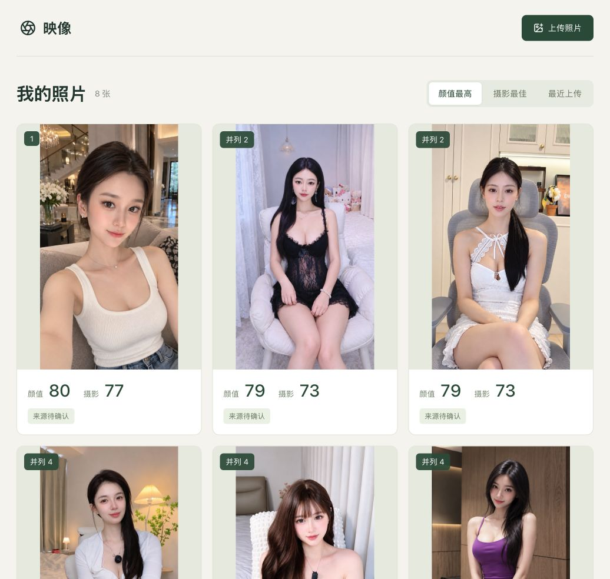

# 颜选 · BeautyPick

[English](./README.md) | 中文

## 项目简介

颜选（BeautyPick）是本地人像评估与选片应用，提供Agent Skill调用入口。颜值采用本地模型整体评分，身材与摄影使用本地测量规则。分数反映模型偏好与启发式规则，不是客观颜值或经过验证的解剖学判断；正式评分无需Codex账号。

当前版本：**0.2.0**，详见[版本记录](./CHANGELOG.md)。

## 效果预览



## 核心功能

| 能力 | 它能帮你做什么 |
|---|---|
| 颜值骨相综合评估 | 固定标准裁脸后由ResNet50输出整体分，不编造独立部位评分；旧标尺最高可截顶到99分。 |
| 身材体态比例分析 | 评估肩胸、腰腹、臀胯与腿部线条，严格解耦拍摄姿态（高低肩不扣分）并按可见部位动态归一。 |
| 摄影光学精细评分 | 采用 0.1 连续精细浮点分体系，依据 Tenengrad 锐度、面部专属测光与景深虚化分离比拉开梯度。 |
| 来源凭证与防伪核验 | 解析 C2PA 数字凭证与 EXIF 元数据，准确区分相机直出、AI 生成与后期编辑记录。 |
| 智能选片对照排行 | 在多张候选人像中基于已有客观技术分进行确定性多维横向排序，辅助快速挑片。 |

## 安装

### 配置要求

使用颜选 · BeautyPick 前，请确保运行环境满足以下基本条件：

| 项目 | 要求 |
|---|---|
| Agent 客户端 | Google Antigravity、OpenAI Codex 或 Claude Code |
| Python 环境 | Python 3.10 或更高版本 |
| 操作系统 | macOS（推荐 Apple Silicon 硬件加速）、Linux 或 Windows |

### 快速安装

向你的 Agent 客户端发送自然语言指令以安装技能：

```text
请从 https://github.com/chemny/beauty-pick 安装 beauty-pick 技能
```

## 快速开始

向你的 Agent 发送日常对话指令开始评估人像照片：

```text
帮我用颜选评估这张人像照片，分析一下颜值骨相、身材比例与摄影构图。
```

若使用本地可视化 Web 界面，直接运行 `./start.sh` 并访问 `http://127.0.0.1:8765` 即可。

## 使用示例

### 多图对比与挑片选优

```text
对比我相册里的这几张人像照片，使用 beauty-pick 按摄影构图和清晰度给出最佳推荐。
```

### 检查照片来源凭据与防伪

```text
检查这张照片的 C2PA 数字凭证和 EXIF 元数据，确认它是相机拍摄还是 AI 生成的。
```

### 获取拍摄与姿态改善建议

```text
使用 beauty-pick 分析这张照片的采光和头顶留白，给出改善面部受光与构图呼吸感的实操建议。
```

## 工作原理

颜选正式入口使用本地评分，Agent通过CLI/API调用应用：

1. **本地评分引擎**：颜值从关键点生成固定12%边距、无旋转的224×224正方形输入，由原ResNet50输出整体分，沿用旧显示换算。没有独立部位评分；99分可能来自显示截顶，不能理解为接近完美。身材和摄影继续使用本地测量规则。
2. **身材姿态解耦引擎**：通过 BlazePose 33 个骨骼关键点测算动态，模特单肩抬起、侧倾或摆拍动作独立归为造型动作，严格与身材形体评分隔离。
3. **服务与任务队列层**：基于 FastAPI 调度异步评估队列，并在 SQLite（`data/portrait.db`）中保留完整测评台账与快照。
4. **Agent 交互契约层**：标准 `SKILL.md` 规范结合 Pydantic 校验，确保输入输出精准受控。

## 目录结构

```text
beautypick/
├── SKILL.md                  # 根目录 Agent Skill 入口与操作规约
├── references/               # 系统架构参考与 REST API 端点契约
├── app/                      # FastAPI 后端服务、评分算法与 CLI
│   ├── scoring.py            # 维度权重、评分 Schema 与评分准则
│   ├── provider.py           # 客观物理度量引擎编排与算分公式
│   ├── beauty_model.py       # ResNet50 整体偏好评分与面部几何辅助
│   ├── photo_model.py        # Tenengrad 锐度、曝光与构图光学指标
│   └── pose_model.py         # 姿态骨骼关键点提取与造型姿势解耦
├── web/                      # React 19 + TypeScript + Vite 前端工程
│   └── dist/                 # 预编译生产静态产物（免装 Node.js/npm）
├── models/                   # 本地离线模型文件与 CAI 信任锚
├── scripts/                  # 模型下载与校验工具脚本
├── assets/                   # 效果预览截图与公开示例素材
├── setup.sh                  # 一键环境初始化与 Skill 自动注册脚本
├── start.sh                  # 服务启动脚本
└── requirements.txt          # Python 核心依赖定义
```

## 许可

本项目采用 [MIT 许可证](LICENSE)。

`models/` 目录中的预训练模型遵循 Google MediaPipe 和 Content Authenticity Initiative 官方开源许可规范。

## 关于我

由 [@chemny](https://github.com/chemny) 维护。专为摄影师、创作者与开发者设计，旨在通过 AI Agent 提供本地人像评估与辅助选片工具。欢迎通过 GitHub Issues 交流反馈与贡献代码。
