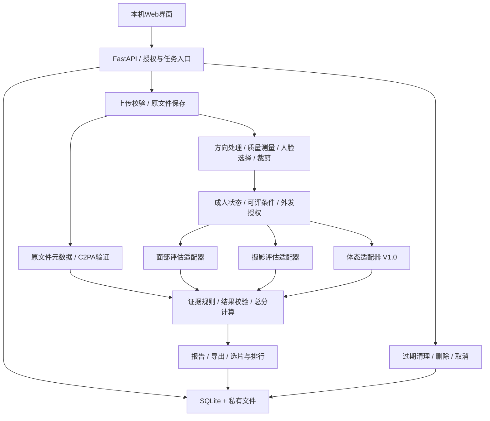

# 颜选 · BeautyPick：架构设计

> 本机实现与用户后续确认已更新，最新决策见文末“2026-10-14”更新；实际验证范围见 [验证记录](validation.md)。早期“暂不编码”状态已被用户后续开发授权覆盖。

版本：规划稿0.1｜日期：2026-10-14｜状态：待审阅；所有组件与接口均为设计，未实现。

关联：[需求](requirements.md) · [决策](decisions.md) · [测试](test-cases.md) · [推进清单](../TODO.md)

## 1. 总体方案

模块化单体：React + TypeScript + Vite负责交互；FastAPI为唯一业务后端，发布时托管前端静态构建产物；SQLite存元数据和状态，专用本地目录存原图与派生文件。评估核心不依赖HTTP或页面，后续CLI/Skill调用同一核心。

V0.1默认Mac本机、单用户、单服务进程、限并发执行。不引入Next.js服务、Redis、Celery、微服务、多Agent或云存储。具体Python/Node/依赖版本在M0兼容性验证后锁定，不在规划阶段安装。

## 2. 模块与职责

| 模块 | 职责与边界 |
|---|---|
| 上传与资产 | 文件头/解码/资源校验、UUID及哈希、原文件不可变保存 |
| 图像处理 | Pillow/OpenCV；方向、缩放、测量、裁剪；不执行五官编辑或自动美化 |
| 人脸处理 | MediaPipe候选，先测本机兼容性；不做人脸身份匹配 |
| 来源证据 | c2pa-python候选；元数据提取、签名/绑定/信任状态分离；受控信任配置 |
| 评估核心 | 可评状态、规则版本、评分计算、模块隔离与语义校验 |
| 模型适配器 | 视觉输入、结构化输出、超时/重试/用量；暂定Codex gpt-6.1-sol medium，调用方式待验证 |
| 比较与选片 | 人工分组、目标选片、可比性、平局和排序不确定性 |
| 任务执行 | SQLite持久化状态，单进程受限执行器；应用重启恢复中断状态 |
| 报告 | 可读结果、脱敏导出、历史快照；对不可信内容转义 |
| 生命周期 | TTL、授权变更、删除标记、任务取消和迟到结果丢弃 |

## 3. 单图数据流

1. 用户确认照片处理权限，选择模块；本地上传不自动授权第三方。
2. 校验实际类型、字节数、像素、帧数和可解码性，随机资产ID，原始字节保存于私有目录。
3. 在原始字节上读取元数据、验证来源凭据，固定验证器与信任配置版本。此步骤必须先于清洗或重新编码。
4. 生成方向校正的工作图。首版仅裁切、缩放和方向变换，不调曝光，不补全被遮挡面孔。
5. 检测人脸。多脸时等待目标选择；无脸时面部不可评但来源/摄影仍可运行；检测器失败单独报告。
6. 生成目标裁脸并检查质量。关键点检测置信度只用于定位，不当作审美可信度。按维度记录限制。
7. 检查成人状态、模块开关、提供商授权及预算。面部仅外发裁脸，摄影仅在授权后外发去元数据整图。多人整图的第三方授权范围需包含整图；只授权目标脸时跳过整图语义分析。
8. 模型返回结构化观察、子分与限制；服务端验证类型、范围、状态、依据和内容边界，并自行计算总分。来源平台归因不由模型决定。
9. 持久化版本化结果快照，生成报告；失败模块不覆盖成功结果，未授权模块标未启用。
10. 到期或用户删除时取消关联任务，清理原图、派生图、报告及缓存。任务写回前重新检查删除状态与授权版本。

## 4. 核心实体与结果契约

下表为概念数据模型，非已完成数据库Schema。

| 实体 | 关键字段 |
|---|---|
| Project | id、名称、temporary/retained、created_at、expires_at、deleted_at |
| Asset | id、project_id、sha256、真实MIME、尺寸、大小、原文件引用、生命周期状态 |
| FaceTarget | asset_id、target_id、区域、方向/裁剪变换版本；不含身份嵌入 |
| Consent | asset/project范围、处理权限、成人状态、提供商、模块、外发图范围、时间、版本 |
| Job | id、asset/target、requested_modules、状态、模块状态、attempt、错误、用量、取消/删除标记 |
| Evidence | 类型、原始来源字段、验证器、签名/绑定/信任、支持的声明、冲突、验证时间 |
| Assessment | 模块、状态、各维度子分/依据/限制、total、规则/提示/模型版本、输入哈希、时间 |
| CandidateGroup | project_id、人工标签、成员、声明关系、选片目标、代表照及人工覆盖记录 |
| Comparison | 两个评估快照、目标/规则版本、胜负/平局/不可比、依据、缺失与冲突 |
| Preference | 模块、维度定义版本、权重、锚点版本；保存后版本不可变 |
| Report | 评估与比较快照引用、格式、是否内嵌图片、脱敏策略、保留状态 |

模块状态：completed / partial / not_enabled / not_assessable / failed。维度状态：assessable / insufficient / not_assessable。任务状态：queued / running / completed / partial / failed / cancelled / interrupted。删除状态独立记录，不以任务取消替代数据删除。

所有不可评分值为null；有效0分保留0。总分仅在必要维度均可评时计算。report schema_version与rubric_version分离；缓存和导出均保留版本信息。

来源结构：category、manifest_status（absent/valid/invalid/indeterminate）、signature_status、asset_binding_status、signer_trust（trusted/untrusted/unknown）、platform（可空）、evidence[]、conflicts[]、limitations[]、evidence_level。只读到自签名有效凭据时不得升级为可信平台。

## 5. 模型接入边界

用户指定的Codex模型名不直接当作公开HTTP API模型ID。当前不确认其产品运行时可用性，不把聊天窗口当作后端接口，不读取或挪用Codex内部凭证。

M0验证候选官方/受支持调用方式是否具备：视觉输入、gpt-6.1-sol选择、medium参数、结构化结果、无人值守调用许可、超时/取消行为、调用计费与数据处理说明。开发时查官方资料并做获准的小样调用。

- 若全部满足：实现该适配器，记录实际模型返回标识及可审计配置。
- 若仅开发助手可使用该模型、产品无法调用：报告阻塞，保留本地检查路线，征求用户选择运行时服务；不擅自换成Gemini或其他模型。
- 若无金额计费数据：用量/次数/时间如实显示，不把Codex订阅额度转换成虚构单图API价格。金额预算只有在存在可信费率和调用用量时启用，否则使用调用次数等硬上限。

开发助手配置、应用配置和报告中的实际模型标识分开；文档中写下medium不代表已更改当前聊天配置。

## 6. 拟定HTTP边界

只作为实现阶段接口草案：

| 操作 | 用途 |
|---|---|
| POST /assets | 受控上传，创建临时资产 |
| GET /assets/{id} | 当前会话授权下的基本信息与处理状态 |
| GET /assets/{id}/preview | 受控图片访问，不返回任意本地路径 |
| POST /assets/{id}/target | 选择目标和裁剪版本 |
| POST /assets/{id}/consents | 记录处理范围与成人状态 |
| POST /jobs | 提交指定模块，服务端重检授权/预算 |
| GET /jobs/{id} | 状态与部分结果；前端轮询即可 |
| POST /jobs/{id}/cancel | 取消后续处理 |
| GET /reports/{id} | 报告及受控导出 |
| DELETE /assets/{id} | 标记删除、取消任务、清理关联内容 |

批量、项目、分组、偏好、历史与比较接口在对应版本细化。所有写操作需本机会话保护，检查Origin/Host、跨站请求及资产访问范围；默认不开宽松CORS。

## 7. 存储、缓存、删除与重启

- 文件目录与公开静态目录隔离；数据库不存Base64。文件名采用内部ID，不信任用户路径。
- 临时资产默认上传后24小时到期；任务及派生数据不延长TTL。主动保存后的保留范围与继承关系需用户可见。
- V0.1无永久历史入口；V0.2项目默认临时；V1.0加入主动保存历史及版本比较。
- 定期清理与启动清理同时存在；停止应用期间无法实时清理，到下次启动补清理，界面如实说明。
- 删除先写持久标记，再取消/阻止写入并清文件。清理失败记录待重试状态，不提前显示已彻底删除。
- SQLite删除记录及WAL处理要纳入验证；普通文件删除不承诺磁盘取证级擦除，系统备份与导出文件不由应用自动销毁。
- 重启时running任务变interrupted，未授权/已过期任务不重新外发。用户可重试，避免重复计费。
- 缓存键包含图片内容、目标裁剪、模块、规则定义/锚点/权重、提示版本、模型/推理配置、处理参数和授权范围；不跨授权项目自动复用。
- 文件引用按项目隔离，重复文件可提示但初版不共享物理存储，简化删除语义。

## 8. 安全、预算与可观测性

默认127.0.0.1；非本机访问不是响应式页面的自动副作用。局域网/自托管需认证、传输保护和访问控制后另行验收。

上传拒绝路径遍历、伪装格式、超大像素、动画和异常解码。解码/模型任务设资源和时间上限；导出转义EXIF、文件名和模型文本，不加载不可信脚本。

C2PA不自动追踪任意远程URL。默认使用本地凭据和预置/显式更新的信任配置；需要网络验证时标明目的与授权，防止SSRF和隐性外发。离线无法完成的信任检查显示indeterminate。

模型输出、图片内文字和EXIF均为数据，不得当作指令。评估适配器无浏览器、文件删除、命令执行等工具权限。有限重试计入预算，不自动更换提供商或放宽成人门槛。

日志仅记录内部ID、状态、耗时、错误码及用量，不记录图片、完整提示、密钥、GPS。费用估计与实际值分开；每日预算在请求前预留、完成后核算，金额无法可靠获得时不得声称严格金额封顶。

## 9. 后续版本架构约束

- V0.2：人工分组，代表照必须通过可评/可比条件检查；用户可覆盖推荐。
- V0.3：固定规则/模型/提示快照比较；两两结果保留平局、循环和缺边。算法确定前不实现排行榜。
- V1.0：体态仅主动开启，独立可评门槛；CLI/Skill经同一授权及核心校验路径，不绕过隐私控制。
- 历史报告不可静默覆盖。权重重算生成新派生报告；模型/定义变化重新评估并记录外发与费用。

## 10. 未验证的关键风险

模型运行时调用路径；Mac下MediaPipe/C2PA原生依赖兼容性；可信签发者配置与测试凭据；评分锚点及稳定性；取消后清理一致性；多图比较调用增长。M0先消除前三项技术风险，再做产品实现。

## 2026-10-14 实现更新

实际技术栈为 React/TypeScript/Vite 前端 + FastAPI/Pydantic + SQLite，本机单进程服务；Pillow、OpenCV、MediaPipe Tasks BlazeFace处理本地图像，c2pa-python离线核验内容凭据。版本锁见根目录requirements.lock及web/package-lock.json。

运行时采用用户确认的已登录Codex CLI：临时目录、只读sandbox、工具能力关闭、每模块独立图片/提示与结构化输出、180秒总超时、进程组取消。CLI原生认证不复制到应用。服务本机会话Cookie + 同源请求校验 + 写请求Token；不开放公网。

来源模块将密码学签名、数据绑定和证书信任分开。模型不参与来源平台认定。面部裁脸与摄影/体态整图分开；可授权仅裁脸。体态半身等场景通过服务端强制清空比例项和总分。

compare模块只读取兼容报告的原子分，根据偏好重算，逐对列出分项差异。它不做独立视觉两图判断；近似分阈值2分，不构造循环胜负。每组一张代表照，缺失与不兼容结果单独列出。

CLI是HTTP客户端，Skill调用CLI；不另写一套评分和权限实现。历史报告是快照；默认24小时到期，主动保存后保留。删除取消任务并清除图片/裁脸/报告/引用，临时调用副本随取消退出清理。导出文件由用户单独管理。
